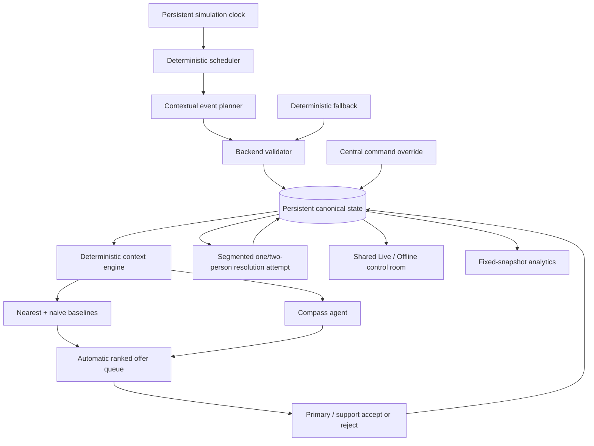

# ResponseCompass

**Not just who's closest. Who makes the most sense.**

ResponseCompass is a context-aware responder-dispatch agent inside a persistent simulated control room. An existing operational system decides what needs attention; Compass automatically finds who should respond to each issue right now.

The governing boundary is:

> Code establishes the evidence. Compass ranks the match. Responders accept asynchronously. Central command may override.

This is a net-new, synthetic project. It contains no LOCI source, proprietary facility context, real personnel data, or production credentials.

## What is implemented

- persistent simulation clock with pause/resume; the UI offers 1× and 5× (the API also accepts 10× and 60×);
- deterministic one-shot scheduler with bounded cadence and no restart catch-up;
- a dedicated Demo view with visible agent activity and Trigger Next Event / Force Resolve controls;
- a default 2D manufacturing-floor map with three-floor selection, drag pan, wheel/button/keyboard zoom, and an optional 2.5D overview;
- contextual structured event planner plus deterministic seeded fallback;
- up to three concurrent issues, one or two exclusive responders per issue, waiting behavior, and stale protection;
- automatic support matching for complex or delayed work, plus roster-versioned central release and cross-issue transfer;
- hidden per-responder/per-class simulation truth blended with confidence-weighted same-class history for stochastic resolution outcomes;
- runtime resolution history, success, failure/reopen, responder release, and downtime tracking;
- bounded live Compass context with nearest and auditable naive-score baselines;
- revision-safe structured Compass results, automatic offer/accept/reject dispatch, central override, and audit records;
- persistent event feed with explicit baseline-disagreement markers;
- clickable, on-demand issue audit trails with complete Compass analysis, offer history, control-center overrides, and resolution actions;
- fixed-snapshot P0 analytics with denominators and thin-sample safeguards;
- API-free deterministic Offline Demo using the same offer/accept and override interaction;
- 230 automated tests, a 100-opportunity deterministic soak, and 32 Chromium E2E tests.

## Architecture



Application code owns time, facts, eligibility, metrics, baselines, validation, simulation outcomes, and all mutations. Models may only propose one bounded event or rank the eligible candidates supplied to them. Neither model sees `ResponderSkill`; the normal UI/API and analytics do not expose it either. See [architecture details](docs/architecture.md).

## Run locally

Requires Node.js 22+.

```sh
npm ci
npm run dev
```

Open `http://127.0.0.1:3000`. The server binds `0.0.0.0` by default for LAN demos; use `COMPASS_HOST` and `COMPASS_PORT` to override it. Live state persists under ignored `backend/data/` by default; set `COMPASS_DATA_DIR` to relocate all persistent application state. Simulation time does not advance while the process is stopped.

The application reads an optional `.env` automatically:

```sh
cp .env.example .env
```

ResponseCompass uses one model provider: **AMD Token Factory** (OpenAI-compatible, `https://developer.amd.com.cn/radeon/api/v1`). Set the team key with `AMD_TOKEN_FACTORY_API_KEY`, or point `AMD_TOKEN_FACTORY_API_KEY_FILE` at a file containing only the key, and leave both Live modes set to `live`. The key stays server-side and is never sent to the browser. The default model is `MiMo-V2.6-Flash` with reasoning `none`. Without a key, or whenever AMD is slow, rate-limited, unavailable, or returns output that fails validation, Live event generation and responder matching fall back deterministically, so dispatch continues without a model response.

The Settings tab lets an operator save a key and pick another AMD model and reasoning level at runtime, without editing `.env`. See [Compass_AMD_Token_Factory_Integration_Guide.md](Compass_AMD_Token_Factory_Integration_Guide.md) for the service's limits and terms.

Offline Demo is always hard-pinned to the committed fixture, regardless of Live environment settings, and never makes an API request.

## Docker deployment

The supplied Compose service runs ResponseCompass on port 3000 with a named `compass-data` volume. It is intentionally configured with a read-only container filesystem, a writable `/tmp` tmpfs, dropped Linux capabilities, and a non-root application user. The `.env` file is read only at container runtime and is excluded from the image build context.

```sh
docker compose up -d --build
docker compose ps
```

The health check calls `GET /api/control-rooms` and passes only when every configured room reports `READY`.

### Switchover, data migration, and rollback

Stop the existing non-container ResponseCompass process before binding Docker to port 3000. Do not run both processes against the same state directory or port.

Docker begins with an empty named volume. To retain an existing local deployment, first stop ResponseCompass, take a verified backup of its complete `backend/data/` directory, then copy that backup into the **empty** `compass-data` volume using a one-off container. Do not automate or retry-copy into a nonempty volume: legacy room migration is intentionally conflict-safe and must not be bypassed by overwriting state. Start Compose only after validating the copied file set and retain the source backup.

If the container fails its health check or a post-switchover validation, stop Compose, keep the named volume unchanged for inspection, and restart the former process from the verified backup/data directory. Do not delete the volume as a rollback step. See `docs/handover-history.md` for the operator checklist.

## Demo controls

- **Resume / Pause** controls simulation time.
- **Speed** selects 1× or 5× without replacing the current timer. Live AMD rankings take about 40–90 seconds, so faster speeds outrun them; the API still accepts 10× and 60× for offline generation.
- **Demo** opens a dedicated activity monitor and keeps presentation-only shortcuts out of the normal operating controls. The navigation status pill remains visible while an agent is working.
- **Trigger Next Event** immediately executes the validated scheduler path and respects the active-issue ceiling.
- **Force Resolve** immediately consumes the selected assigned issue's one-shot token. The result still uses the normal skill/history probability and variability model; it bypasses waiting, not outcome logic.
- **Issue staffing** can request a second responder, release either member of a two-person roster, or transfer one responder from another two-person issue. Primary promotion is automatic and every roster change replans remaining work without rerolling the outcome.
- **Reset** resets only the active mode; switching to Offline does not erase Live history.

## Verification

```sh
npm test
npm run test:e2e
```

`npm test` includes contracts, persistence, clock/scheduler idempotency, planner fallback, multi-issue races, latent resolution, live recommendations, assignments, analytics, Offline reset, convergence, and a 100-opportunity soak.

Playwright may require Chromium system libraries. In this build environment the successful command was:

```sh
LD_LIBRARY_PATH=/home/makodev58/rendertest/libs/usr/lib/x86_64-linux-gnu npm run test:e2e
```

See [evaluation results and limitations](docs/evaluation.md). The deterministic policy proves state integrity and seed disagreement capacity; it is deliberately not presented as a live-model quality result. Genuine provider sign-off requires credentials and pinned model IDs.

## Analytics and ethics

Rates always include denominators and are suppressed as **Insufficient data** below three observations. **Issue-Class Experience** is alphabetically ordered, emphasizes cases, and is not an employee ranking. Compass excludes compensation, seniority, demographics, biometrics, personality, fatigue, disciplinary data, and general HR scoring. A responder with no prior issue-class history remains eligible.

## Operational diagnostics

The application persists up to 1,000 structured runtime log events in the ignored local data directory. Retrieve them with `GET /api/logs` or `GET /api/logs?limit=25`. Browser failures are reported to `POST /api/logs/client`.

## Source of truth

[`Compass_ResponseCompass_SOW_v4_FINAL.md`](Compass_ResponseCompass_SOW_v4_FINAL.md) is the product specification. Material implementation decisions are recorded in [docs/decisions.md](docs/decisions.md), agents coordinate through [handover.md](handover.md), and merged handoffs are archived in [docs/handover-history.md](docs/handover-history.md).

The generic control rooms are **e8-aura-p1** (`/rooms/plant-1`) and
**e8-aura-p2** (`/rooms/plant-2`). Compass ranks eligible responders from aggregate
simulated history; MES integration and case-guided response plans are not included.
