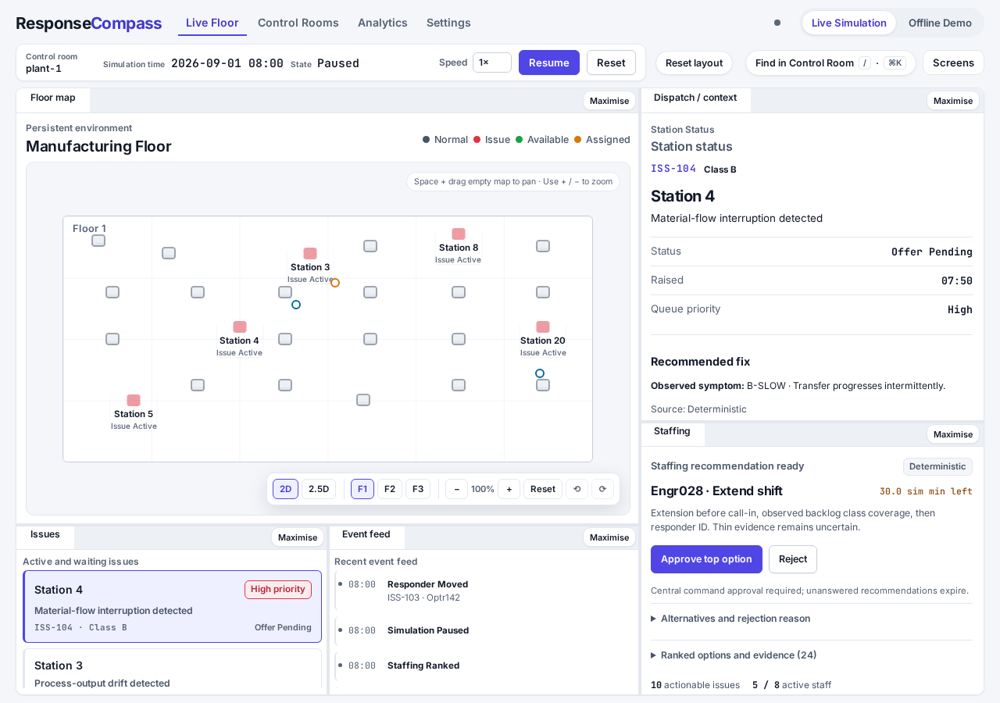
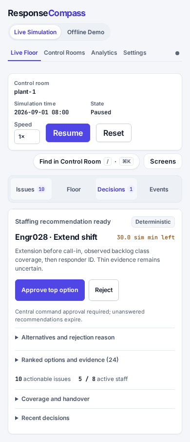

# Operational UI refinement

User-authorized refinement of the [Modern light](modern-light.md) system, 18 October 2026.
Keep its colours, local fonts, contrast rules and shared Live/Offline presentation.
The hierarchy is room/state → current task → action → supporting evidence.

## Staffing

The pending recommendation leads with source, person, extension/call-in, simulated
minutes remaining, rationale and approval/rejection. The primary approval is indigo;
rejection stays secondary. Actions stick within the scrolling tile. Alternative selection
and an optional rejection reason share a disclosure; ranked evidence, current coverage
and recent decisions have separate disclosures. The explicit policy explanation stays
beside the actions. Every approval still uses the supplied recommendation revision and
server-side revalidation; presentation never changes eligibility or deadlines.

A short empty state replaces the full recommendation when there is no decision pending.
Frozen evidence timestamps, baseline comparison, source and canonical audit facts remain
accessible. Forms, focus, disclosure state and tile scrolling survive polling while the
same recommendation remains current; a replacement starts with fresh decision inputs.

## Phone workspace

At widths up to 900px the four labelled buttons show Issues, Floor, Decisions or Events.
Issues is the initial view, containing the issue queue and existing detail/dispatch panel.
Selecting an issue or feed record reveals its details; Floor retains the same map, controls
and geometry. The Decisions badge counts actual pending recommendations, never inferred
urgency. The switcher is presentation state, separate from shared server state.

The DOM nodes remain the same when Dockview activates above 900px. No panel, keyboard
control or audit record is removed. Standalone wall displays bypass phone navigation.

## Analytics

Section links provide Overview, Reliability, Staffing and Experience navigation. Pareto
sits immediately after headline metrics and ahead of detailed trend/response tables.
Responder and issue-class tables are expandable; headings and the non-ranking caveat stay
visible. Expanded sections and active search survive refreshes. Pareto retains its own
DOM, query state and event handlers when the surrounding analytics markup updates.

Unavailable headline rates use an em dash with the full insufficient-data explanation
and denominator beneath. Table values, denominators and suppression rules are unchanged.
Current snapshot, lifetime outcomes and selected chart periods remain explicitly distinct;
no global filter is implied for metrics that the backend does not filter.

## Shared styling

Use existing tokens, 6px controls and 10px panels, consistent 8–24px spacing and restrained
borders. Names lead task rows; IDs, times and figures stay in mono metadata. Event rows
retain every record and use a quiet timeline marker. Equipment uses a slightly rounded
machine glyph, responders remain circular, and issue status remains distinct from focus.

API settings separate deployment-wide credentials from two balanced model-role cards,
stacking below 700px. The active room ID appears with simulation status; existing directory/rename
responses can replace it with the display name, without fetching the room directory at boot. The shell stays compact; no extra permanent sidebar is introduced.
Honour reduced motion and maintain visible keyboard focus and contrast.

## Verification

Review pending/idle staffing, expanded evidence, alternatives, rejection, stale responses,
Analytics disclosure/search persistence and mobile task transitions. Test phone widths,
1280/1440 desktops, breakpoint transitions and 1920×1080 displays. Run both repository
suites with forced providers on Codex ports; never use the live room's data for previews.

Pending decision requests disable actions across the shared staffing views until the
request settles. Polls cannot re-enable a second submission. If both the submission and
its immediate refresh fail, the existing decision remains editable for a retry; server
revision and lawfulness checks remain the authority.

## Review captures

Isolated synthetic preview, forced providers, paused at the seeded simulation time:

The desktop Staffing wall screen increases the recommendation, source, deadline and
action sizes for reading at a distance; the ordinary tile retains its compact density.
